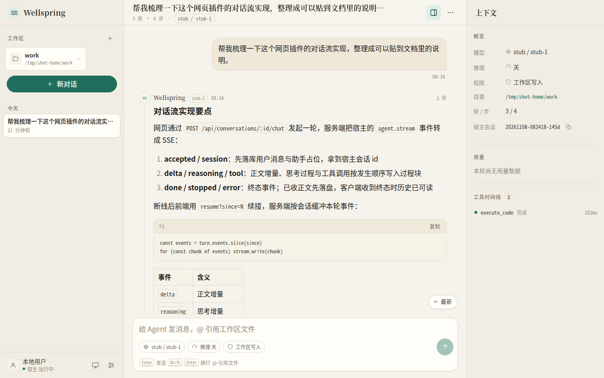
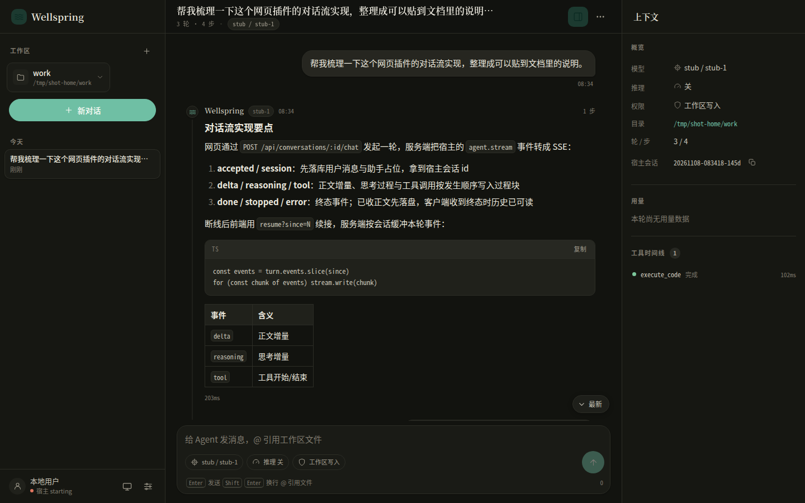
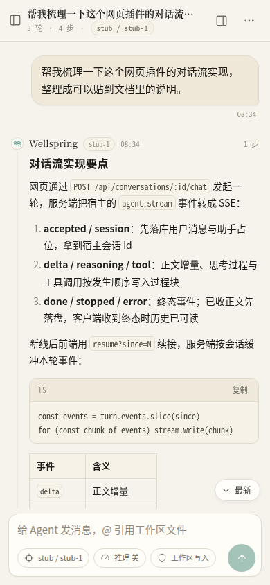

# @xyit/wellspring-web

Wellspring 的网页对话界面插件：在浏览器里与 Agent 实时对话——流式回复、思考过程、工具调用、停止与插话、
Agent 提问与提权审批、会话续接、模型/权限切换、工作区文件引用。

- 前端 **Vue 3 + Vite**，构建产物随插件包下发（`www/`），不依赖外部 CDN，严格 CSP
- 后端是插件自己的 HTTP 服务（`api.http`），会话与流式状态都在插件进程内
- 统一登录由 **wellspring-gateway** 负责；直连插件端口时复用网关会话 cookie



## 功能

- **流式回复**：正文增量渲染；思考（reasoning）折叠显示，工具调用按发生顺序穿插，参数与输出可展开
- **停止与插话**：停止是服务端行为（`agent.stop`），已收正文保留；插话在下一个模型调用前注入同一轮
- **提问与审批**：Agent `ask` 工具在对话里出卡片（单选/自定义/跳过）；提权请求显示命令、目录、权限变化与理由，
  默认焦点在「拒绝」，宿主 120 秒超时自动拒绝
- **会话续接**：刷新、断网、切后台后自动续接进行中的一轮；宿主重启后仍可用 `sessionId + cwd` 继续会话
- **会话管理**：按日期分组、运行中标记、重命名、删除、记住最近打开的会话
- **模型 / 推理强度 / 权限**：会话级选择；新会话沿用最近一次选择与宿主默认
- **工作区**：使用宿主工作区注册表，可调用系统目录选择器添加；`@` 引用工作区文件
- **Markdown**：标题、列表、任务列表、引用、表格、代码块（语言标签与复制）、链接白名单
- **用量**：每轮输入/输出/缓存读取/上下文占用，会话累计在侧边检查器里
- **主题与响应式**：跟随系统/亮/暗；桌面三栏，窄屏抽屉与单栏输入
- **多会话并行**：不同会话各跑各的；同一会话一轮串行（运行中再发返回 409）

| 暗色 | 手机 |
| --- | --- |
|  |  |

## 架构

```text
浏览器
  ├─ 网关路径：http://127.0.0.1:8780/web/ ──▶ wellspring-gateway（登录/TLS）
  │                                            └─▶ 127.0.0.1:8787 wellspring-web（注入 x-wellspring-user）
  └─ 直连端口：http://127.0.0.1:8787/      ──▶ wellspring-web（校验 wellspring_session cookie）
                                                    │
                                                    ├─ 静态：插件包内的 www/
                                                    └─ 对话：宿主 api.agent.stream → SSE
```

- 插件用宿主原语 `api.http.createServer` 监听 loopback（默认 `127.0.0.1:8787`），
  启动时通过事件总线把地址注册给网关（前缀默认 `/web`）
- 经网关的请求已由网关完成鉴权，用户放在 `x-wellspring-user` 头里；直连端口读网关的
  `sso.json` / `sessions.json` 本地校验会话 cookie（需要 `wellspring-gateway` >= 0.5.0）
- 前端请求走相对路径，`index.html` 由服务端按网关的 `x-forwarded-prefix` 注入
  `<base href="/web/">`，因此 `/web/` 与直连 `/` 两种入口用同一份构建产物
- 与宿主的桥接：`api.agent.stream/stop/interject/respondAsk/respondApproval`、
  `api.models`、`api.workspaces`、`getHost`；会话记录持久化在插件数据目录

## 安装与加载

需要宿主 `@xyit/wellspring` >= 1.7.6、`wellspring-gateway` >= 0.5.0。

```bash
wellspring plugin link "$PWD"          # 本地开发
# 或 wellspring plugin install npm:@xyit/wellspring-web

wellspring start
```

打开 `http://127.0.0.1:8780/web`（先登录网关），或直连 `http://127.0.0.1:8787/`。

## 访问与登录

| 入口     | 地址                         | 登录方式                                                          |
| -------- | ---------------------------- | ----------------------------------------------------------------- |
| 网关路径 | `http://127.0.0.1:8780/web/` | 网关 `/login`；登录后网关转发请求并注入用户头                     |
| 直连端口 | `http://127.0.0.1:8787/`     | 同一个 `wellspring_session` cookie；未登录 302 到网关登录页并回跳 |

- 会话 cookie 是 host-only：同一主机（`127.0.0.1`）任意端口共享，`127.0.0.1` 与 `localhost` 不互通
- 直连要求与网关同协议：TLS 的 `Secure` cookie 不会发给 http 端口；网关是 https 时直连 http 端口返回
  `503 直连端口需与网关同协议`
- 页面请求未登录时 302 到网关 `/login?redirect=<当前地址>`，登录后回到原地址
- 登录地址的主机名沿用浏览器当前使用的主机名，网关需监听该地址
- `Accept` 为 `application/json` 等非页面类型时未登录返回 `401 {"error":"unauthorized"}`；
  浏览器默认 `*/*` 按页面处理
- 静态资源与接口同样需要登录；只有 `GET /__web/health` 不需要
- 会话快照读不到时直连端口返回 `503 会话校验不可用`；同一会话短时间重复校验失败返回
  `503 会话状态不同步`，避免与网关回跳形成重定向循环
- 伪造的网关头在 Host 不在白名单时返回 `403 Host 不受信任`（防 DNS rebinding）
- `GET /__web/health` 返回 `{ status, version, user, sso, allowedHosts }`，`sso` 为
  `gateway`（校验网关会话）/ `disabled`（网关鉴权关闭）/ `off`（读不到网关发现文件）/
  `unavailable`（发现文件损坏，直连拒绝服务）

## 配置

`<configDir>/plugins/wellspring-web.json`，全部可选：

```json
{
    "host": "127.0.0.1",
    "port": 8787,
    "routePrefix": "/web",
    "wwwDir": "/absolute/path/to/www",
    "spaFallback": true,
    "allowedHosts": ["127.0.0.1", "localhost", "[::1]"],
    "limits": {
        "maxMessageChars": 32000,
        "maxReferences": 20,
        "maxBodyBytes": 1048576,
        "maxConversations": 100,
        "maxConversationChars": 600000,
        "turnBufferChars": 4000000
    }
}
```

| 字段           | 默认             | 说明                                                                 |
| -------------- | ---------------- | -------------------------------------------------------------------- |
| `host`         | `127.0.0.1`      | 监听地址                                                             |
| `port`         | `8787`           | 监听端口，`0` 为随机端口                                             |
| `routePrefix`  | `/web`           | 注册到网关的路径前缀                                                 |
| `wwwDir`       | 插件包内 `www/`  | 静态资源根目录（绝对路径）；默认用插件自带的前端产物                 |
| `spaFallback`  | `true`           | 找不到文件且接受 HTML 时回退 `index.html`                            |
| `allowedHosts` | loopback         | 信任网关头时校验的 Host 主机名；自定义项追加到默认项（局域网 IP、域名） |
| `limits`       | 见上             | 单条消息、引用数、请求体、会话数、单会话正文、单轮事件缓冲的限额     |

网关侧不需要写路由：插件启动后自动注册，访问 `http://127.0.0.1:8780/web`（先登录网关）。

## 数据目录

```text
<dataDir>/plugin-data/wellspring-web/
├── chat/
│   ├── index.json                 # 会话摘要索引 + activeId
│   └── conversations/<id>.json    # 会话完整记录（消息、过程块、用量）
└── ...
```

- 旧版插件（0.3.x 及之前）留下的 `www/`、`workspaces/`、`auth.json`、`model-context.json`
  等文件不再使用，也不会被删除
- 会话按创建时的工作目录（`cwd`）与宿主会话 id 成对复用；宿主的模型上下文在宿主自己的
  `sessions/` 目录，本插件只保存展示用的记录
- 同一会话最多保留 100 个；单会话正文（含工具输出等过程块）超过 60 万字符时丢弃最早消息

## HTTP API 与流协议

全部接口挂在插件自己的 HTTP 服务上（`/api/*`），与页面同源。详细契约（字段、状态码、边界）：

- [`docs/ARCHITECTURE.md`](docs/ARCHITECTURE.md) §4（接口）与 §5（数据模型）

主要接口：

| 方法 | 路径 | 说明 |
| --- | --- | --- |
| GET | `/__web/health` | 健康检查（免登录） |
| GET | `/api/bootstrap` | 首屏状态：用户、宿主、模型、工作区、会话列表、限额 |
| GET/POST | `/api/conversations` | 会话列表 / 新建 |
| GET/PATCH/DELETE | `/api/conversations/:id` | 读取 / 修改 / 删除 |
| POST | `/api/conversations/:id/active` | 记住最近打开的会话 |
| POST | `/api/conversations/:id/chat` | 发起一轮对话（SSE） |
| GET | `/api/conversations/:id/resume` | 续接进行中的一轮（`since` / `peek=1`） |
| POST | `/api/conversations/:id/stop` | 停止本轮（幂等） |
| POST | `/api/conversations/:id/interject` | 插话（轮次已结束返回 409） |
| POST | `/api/asks/:askId` | 回答 Agent 提问 |
| POST | `/api/approvals/:approvalId` | 批准/拒绝提权请求 |
| GET | `/api/running` | 正在运行的会话 |
| GET/POST/DELETE | `/api/workspaces*` | 工作区列表、添加（`pick` 调系统选择器）、移除、校验 |
| GET | `/api/files` | 工作区文件搜索（`@` 引用） |
| POST | `/api/files/open` | 用系统默认程序打开路径 |
| GET/POST | `/api/models`、`/api/models/active` | 模型状态 / 切换宿主默认模型 |

对话流是 SSE：`POST …/chat` 返回 `text/event-stream`，事件为 `accepted`、`session`、`step`、
`delta`、`reasoning`、`tool`、`ask`、`approval`、`steer`、`sandbox-prepare`、`stopped`、
`done`、`error`、`truncated`、`replaced`；每 15 秒一行 `: ping`。断线后用
`resume?since=<已收到事件数>` 续接，服务端按会话缓冲本轮事件（5 分钟 / 8 轮 / 4MB）。

写接口需要请求头 `x-web-request: 1`（跨站请求会先触发预检被浏览器拦下），请求体必须是
`application/json`，并校验 `Origin` 与 `Host` 同源。

## 前端开发

前端源码在 `frontend/`，构建产物输出到仓库根目录 `www/`，并**提交到仓库**（插件运行时从插件包读取）。

```bash
npm --prefix frontend install
npm --prefix frontend run dev        # Vite 开发服务器，/api 代理到 127.0.0.1:8787
npm --prefix frontend run typecheck
npm run build:ui                     # 构建到 www/（提交这个产物）
```

- 开发服务器同样需要登录态：先经网关登录，再访问 `http://localhost:5178/`；
  或在网关配置里为开发端口放行（auth 关闭时最省事）
- 目录：`frontend/src/components/chat/`（消息与过程块）、`components/layout/`（三栏与侧栏）、
  `components/composer/`（输入区）、`components/settings/`、`src/store.ts`（全局状态与流式状态机）、
  `src/api.ts`（HTTP + SSE 客户端）
- 不引外部 CDN；Markdown 渲染必须经 `marked` + `DOMPurify`；图标用内联 SVG sprite，不用 emoji

## 构建、测试与发布

```bash
npm install
npm run typecheck        # 插件 TS
npm test                 # 后端单测（node --test）
npm run build:ui         # 前端 → www/
npm run build:zip        # release/wellspring-web-<version>.zip（含 www/）
```

CI（`.github/workflows/ci.yml`）：插件与前端类型检查、构建前端并校验 `www/` 与源码一致、
后端单测、打 zip 并冒烟检查产物。

发布：改 `package.json` 的 version，提交后推同名 tag：

```bash
git tag -a v0.4.0 -m "v0.4.0"
git push origin master refs/tags/v0.4.0
```

推 `v*` 标签触发 `release.yml`（zip + SHA256SUMS 挂 GitHub Release）与 `publish-npm.yml`
（Trusted Publishing / OIDC 发 npm）。

## 安全

- 登录由网关统一负责；直连端口用网关会话快照本地校验（`src/sso-client.ts` 与网关同步）
- 页面 CSP：`default-src 'none'`，仅放行同源脚本/样式与 data: 图片；无内联脚本
- 写接口 CSRF：自定义头 + `Origin`/`Host` 同源 + JSON 请求体 + 1MiB 请求体上限
- 网关头只在 Host 属于 `allowedHosts` 时信任，防 DNS rebinding
- 静态路径规范化，拒绝隐藏文件、越界路径与非法编码
- Markdown 经 DOMPurify 消毒，链接只放行 `http(s)` / `mailto`；不使用 `unsafe-eval`

## 限制

- 直连端口只应监听 loopback；监听非 loopback 地址时启动日志 warning
- 停止是协作式的：宿主在当前步结束后收尾，已发出的模型调用不强制切断
- 提问 5 分钟、提权审批 120 秒后由宿主超时兜底；超时后网页再回答会返回 `stale`
- 事件缓冲 5 分钟 / 8 轮 / 4MB：超出后刷新无法续接该轮（已收到的内容保留）
- 宿主 API 不提供模型上下文窗口，界面只显示本轮 `contextTokens` 与用量
- 「打开路径」由宿主系统命令处理，插件不校验路径是否存在
- 会话文件是插件私有格式；删除插件数据目录会丢失网页侧的历史记录（宿主侧会话仍在）
- 修改前端需要重新构建并更新 `www/`（插件从包内读取，不读取用户手改的 `www/`；
  需要覆盖时把 `wwwDir` 指到绝对路径）
- 发现文件只在启动时读取一次：网关换端口或切换 `auth.enabled` 后需要重启本插件

## 与网关的关系

- `setup().deps` 必须声明 `wellspring-gateway`：加载器保证网关先初始化，注册事件与
  `api.pluginData` 可用
- `sandbox.hostApi` 需要 `logger`、`fs`、`http`、`event`、`agent`、`models`、`workspaces`、`getHost`；
  声明 `hostApi` 会替换默认集合，`agent` 必须显式列出
- 经网关的请求只信任网关注入的 `x-wellspring-*` 头；信任前校验请求 `Host` 主机名在
  `allowedHosts` 内，防 DNS rebinding
- 局域网/自定义域名访问时把该主机名加入 `allowedHosts`，否则网关路径返回 403、直连登录回退到网关地址
- 反向代理必须保留浏览器原始 `Host`：网关用 `Host` 判断登录回跳是否同源，并校验写请求的 `Origin`

## 0.4.0 变更

- 从「静态资源骨架」重写为完整对话界面：新增 `src/chat-store.ts`、`src/chat-runtime.ts`、
  `src/router.ts`、`src/api/*`、`src/security.ts`；前端改为 Vue 3 + Vite（源码在 `frontend/`）
- 静态资源来源从「插件数据目录 `www/`（首次写入骨架）」改为「插件包内 `www/` 构建产物」，
  升级插件即更新界面；`wwwDir` 可覆盖为绝对路径
- 会话数据改存 `chat/` 子目录，不再读写旧版 `auth.json` / `workspaces/` 等文件
- CSRF 请求头改为 `x-web-request`（`x-wellspring-*` 会被网关过滤）
- 页面按网关前缀注入 `<base>`，同一构建产物同时支持 `/web/` 与直连端口
